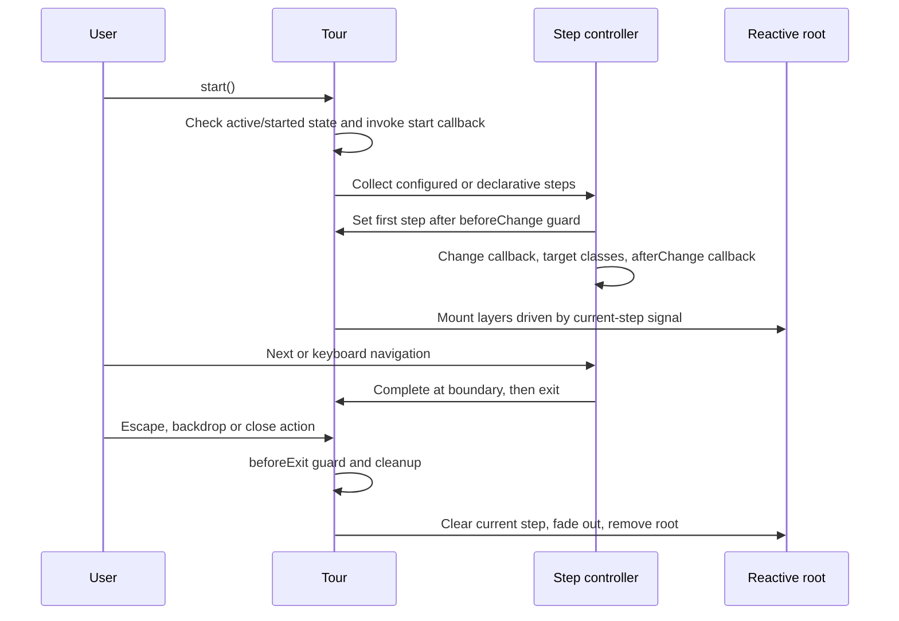

# Intro.js v8.3.2: technical analysis

> Historical behavior and architecture notes used when designing TourKit.
> The reference snapshot was commit `b50a243`, dated 2026-01-04, from
> [usablica/intro.js](https://github.com/usablica/intro.js).
> These notes describe the studied version, not the current upstream release.
> No upstream implementation or stylesheet is distributed with this document.

TourKit's independent design is documented in [mit-design.md](mit-design.md).
The external performance comparison is in
[tourkit-vs-introjs-benchmark.md](tourkit-vs-introjs-benchmark.md).

## 1. Provenance and licensing boundaries

The studied package declared AGPL-3.0 and offered commercial licensing.
TourKit uses its own name, MIT license, `tk-` CSS prefix and independent
implementation. Reference code, comments, styles and other upstream content
must not be copied into TourKit. Public API names appear only where needed
for comparison and the migration adapter. These are development-process notes,
not an assessment of an application's licensing obligations.

## 2. Reference repository structure

The snapshot used TypeScript with strict checking, Rollup builds, Jest/jsdom
unit tests and Cypress end-to-end/visual tests. Tests were colocated as
`*.test.ts` and `*.cy.ts`.

| Area                  | Responsibility                                      |
| --------------------- | --------------------------------------------------- |
| `src/index.ts`        | `introJs.tour()`, `introJs.hint()` and legacy entry |
| `option.ts`           | Option setters and language defaults                |
| `i18n/`               | Translator and language dictionaries                |
| `styles/`             | Main and RTL SCSS                                   |
| `util/`               | Geometry, scrolling, cookies and DOM helpers        |
| `packages/package.ts` | Shared package option/lifecycle interface           |
| `packages/dom/`       | Small reactive DOM framework                        |
| `packages/tooltip/`   | Shared tooltip and positioning                      |
| `packages/tour/`      | Tour steps, components and callbacks                |
| `packages/hint/`      | Hint markers and dialogs                            |

The distribution contained UMD and minified JavaScript, ESM with declarations,
main and RTL CSS, and six separate themes: royal, nazanin, modern, nassim,
flattener and dark. SCSS was processed through the stylesheet build pipeline.

## 3. Public API

### 3.1. Entry points

- `introJs()`: deprecated legacy entry with a warning.
- `introJs.tour(elementOrSelector?)`: create a tour.
- `introJs.hint(elementOrSelector?)`: create hints.
- `introJs.version`: package version string.

The optional element restricts declarative scanning and parents the UI layers;
the default is the document body.

### 3.2. Tour methods

| Group       | Methods                                                                                                                                                                    |
| ----------- | -------------------------------------------------------------------------------------------------------------------------------------------------------------------------- |
| Lifecycle   | `start`, `exit(force?)`, `refresh(refreshSteps?)`, `isActive`, `hasStarted`                                                                                                |
| Navigation  | `nextStep`, `previousStep`, one-based `goToStep`, `goToStepNumber`, `getCurrentStep`, `setCurrentStep`, increment/decrement helpers, `isEnd`, `isLastStep`, `getDirection` |
| Steps       | `addStep`, `addSteps`, `setSteps`, `getSteps`, `getStep`                                                                                                                   |
| Options     | `setOption`, `setOptions`, `getOption`, `clone`                                                                                                                            |
| Persistence | `setDontShowAgain` using a cookie                                                                                                                                          |
| Listeners   | Enable/disable keyboard navigation and refresh on resize                                                                                                                   |
| Callbacks   | Before-change, change, after-change, complete, start, exit, skip and before-exit; lowercase aliases also exist                                                             |

Methods support fluent chaining; asynchronous navigation returns a promise.

### 3.3. Callback behavior

| Callback       | Arguments and behavior                                                   |
| -------------- | ------------------------------------------------------------------------ |
| `beforeChange` | Target, current step and direction; false blocks forward navigation only |
| `change`       | Target before highlighting                                               |
| `afterChange`  | Target after highlighting                                                |
| `complete`     | Current step and `skip`, `end` or `done` reason                          |
| `start`        | Target before step collection                                            |
| `exit`         | Tour instance through callback context                                   |
| `skip`         | Current step when closing                                                |
| `beforeExit`   | Target; false blocks exit unless forced                                  |

Callbacks can be asynchronous and receive the tour as `this`.

### 3.4. Hint methods

The reference API includes `render`/legacy `addHints`, show/hide one or all
hints, `removeHint`, `destroy`/legacy `removeHints`, show/hide a hint dialog,
`refresh`, automatic-refresh controls, outside-click controls, getters and
setters, `addHint`, rendered/active state, and hint-added/click/close callbacks.
Hints share option setters and cloning with tours.

## 4. Options and declarative steps

### 4.1. Tour defaults in the studied version

| Option                                          | Default or purpose                               |
| ----------------------------------------------- | ------------------------------------------------ |
| `steps`                                         | Empty array; otherwise scan `data-intro`         |
| `isActive`                                      | true                                             |
| `nextLabel`, `prevLabel`, `doneLabel`           | Next, Back, Done, localized                      |
| `skipLabel`                                     | Close glyph                                      |
| `hidePrev`, `hideNext`                          | false; boundary buttons otherwise disabled       |
| `nextToDone`                                    | true                                             |
| `tooltipPosition`                               | bottom                                           |
| `tooltipClass`, `highlightClass`, `buttonClass` | Extra CSS classes                                |
| `group`                                         | Filter `data-intro-group`                        |
| `exitOnEsc`, `exitOnOverlayClick`               | true                                             |
| `showStepNumbers`, `stepNumbersOfLabel`         | false, of                                        |
| `keyboardNavigation`                            | true                                             |
| `showButtons`, `showBullets`, `showProgress`    | true, true, false                                |
| `scrollToElement`                               | true                                             |
| `scrollTo`                                      | element; also tooltip or off                     |
| `scrollPadding`                                 | 30 px                                            |
| `overlayOpacity`                                | 0.5                                              |
| `autoPosition`                                  | true                                             |
| `positionPrecedence`                            | bottom, top, right, left                         |
| `disableInteraction`                            | false                                            |
| `dontShowAgain*`                                | Cookie-based checkbox; default lifetime 365 days |
| `helperElementPadding`                          | 10 px                                            |
| `progressBarAdditionalClass`                    | Empty                                            |
| `tooltipRenderAsHtml`                           | true                                             |
| `language`                                      | Detected, with an explicit override              |

A step carries a one-based number, title, content (`intro`), optional element
or selector, position, CSS classes, scroll target and interaction flag. A
missing target produces a floating step.

### 4.2. Hint options

Hints have their own configured list, marker position, animation toggle,
button label and visibility, tooltip position/classes, and automatic refresh
behavior. Nine marker anchors combine top/middle/bottom with left/middle/right.

### 4.3. Attribute discovery

Tour discovery recognizes `data-intro`, `data-title`, `data-step`,
`data-intro-group`, `data-position`, `data-scroll-to`, `data-tooltip-class`,
`data-highlight-class` and `data-disable-interaction`. Hint discovery uses its
corresponding hint text, position, animation and tooltip attributes.

Explicit step numbers reserve slots; unnumbered elements fill gaps in document
order. Hidden elements are skipped, groups filter the candidates, and the
result is sorted by step number. Programmatic steps take precedence.

## 5. Rendering architecture

### 5.1. Reactive DOM layer

The reference implementation includes a TypeScript reactive DOM layer derived
from VanJS, approximately 600 lines at the studied snapshot. It provides state,
derived values, hyperscript tags and DOM mounting. Function properties and
children become reactive bindings. Updates are batched through timers, and
disconnected bindings are collected periodically.

Two important signals are the current step, where undefined means inactive,
and a refresh counter that triggers geometry recalculation.

### 5.2. Page layers

A tour root contains a persistent helper layer and per-step overlay/reference
layers. The reference layer contains the tooltip, including title, close
action, content, opt-out checkbox, bullets, progress, step number and navigation.
An optional interaction-blocking layer covers the target. Root opacity handles
entry and exit; keeping the helper layer across steps allows smooth movement.

### 5.3. Highlighting and stacking contexts

The helper layer follows the target and uses a very large shadow for dimming.
The library raises targets using `.introjs-showElement` and, when needed,
`.introjs-relativePosition`. Table rows require additional cell handling.
Cleanup removes matching classes across the document.

The observed layer hierarchy is overlay 999999, helper 9999998, raised target
9999999, interaction blocker 99999999 and tooltip/reference 100000000.
A target inside a separate stacking context cannot escape that context merely
by increasing its z-index. Transform, filter, containment and opacity can
therefore interfere with this technique.

### 5.4. Fixed targets

When the target or an ancestor is fixed, a dedicated fixed-tooltip class changes
layer positioning to viewport-relative coordinates.

## 6. Tooltip geometry

### 6.1. Coordinates

The reference geometry helpers combine document offsets, special handling for
fixed/relative/sticky containers, and viewport rectangles. Document coordinates
position layers; viewport coordinates determine whether a tooltip fits.

### 6.2. Positions

Supported names include floating, top, bottom, left and right, plus left,
middle and right alignment variants for top and bottom.

### 6.3. Automatic placement

1. Start with the configured side precedence.
2. Remove sides without enough room for the target, tooltip and spacing.
3. Keep the requested side when it fits; otherwise take the first viable side.
4. Fall back to a centered floating tooltip when none fits.
5. For top/bottom, choose horizontal alignment according to available room,
   preserving explicit aligned variants where possible.

### 6.4. Layout and measurement

The tooltip is positioned inside a reference rectangle over the target. Side
placement uses target dimensions plus spacing; edge checks keep it on screen.
Floating positioning centers it and hides the arrow. The studied version uses
an initial estimated size of 300 x 250, then measures actual dimensions after
a short timer and updates placement.

### 6.5. Scrolling

The closest scrollable ancestor is scrolled to expose the target. A separate
window-scroll path checks viewport visibility and centers the target or tooltip
with configured padding; its visibility test includes an additional bottom margin.

### 6.6. Refresh

Tour window resize, and debounced hint scroll/resize, update the refresh signal.
Helper/reference/tooltip layers then measure again. `refresh(true)` also scans
steps and rebuilds the root.

## 7. Tour control flow

The reference keyboard listener uses window capture. Escape exits; arrows
navigate; Enter depends on the focused back/close/bullet action, otherwise it
advances. `goToStep` uses one-based numbering. Before-change cancellation only
blocks forward movement. Completion reasons distinguish Done, advancing beyond
the end and skipping on the last step.

## 8. Hints

Hint items contain a target, text, anchor position, tooltip position/classes,
animation flag, active state and optional tooltip element. Markers use dot and
pulse children. Clicking a marker toggles the shared tooltip; dismissing hides
the marker and invokes the close callback. An outside document click closes
the dialog. Show/hide changes active state, while removal can rebuild the root.
Fixed targets receive a dedicated fixed-hint class.

## 9. Localization

The studied dictionaries are `en_US`, `fa_IR`, `de_DE`, `es_ES`, `fr_FR` and
`ar_SA`. Language detection normalizes browser language names, with an explicit
option override. Applying language defaults in the studied implementation can
overwrite custom button labels. Translation keys group button and message strings.

## 10. Utility responsibilities

| Helpers                       | Role                                                            |
| ----------------------------- | --------------------------------------------------------------- |
| Offset/reference geometry     | Document and viewport positions; fixed-container handling       |
| Fixed/scroll-parent discovery | Walk ancestors and identify positioning or scrolling boundaries |
| Scroll and visibility         | Expose targets and center them when necessary                   |
| Cookie helpers                | Read/write/delete opt-out state                                 |
| DOM events and timing         | Listener wrappers, debounce, sleep                              |
| Class helpers                 | Add/remove classes, including regular-expression cleanup        |
| Style/query/window helpers    | DOM property access and element discovery                       |

## 11. Styling inventory

The reference CSS includes tour, overlay, helper, reference, tooltip, arrow,
header/content/button, bullet, progress, step-number, opt-out, target-raising,
fixed-position and hint classes under the `introjs-` prefix. Styling uses SCSS
variables, separate theme files and a separate RTL stylesheet. The studied
tooltip uses 250–300 px width bounds, border-triangle arrows and 0.3 s transitions.

## 12. Design lessons for TourKit

- Keep host targets in place and remove only TourKit's own mounted root.
- Use an SVG cutout instead of raising targets through stacking contexts.
- Support multiple cutouts without duplicating target elements.
- Render text by default and make trusted HTML an explicit choice.
- Provide focus trapping/restoration, semantic buttons, live announcements,
  valid progress roles and an optional modal mode.
- Measure actual geometry instead of relying on estimated sizes and timers.
- Abstract persistence instead of coupling it to cookies.
- Own listener lifecycles explicitly and prevent conflicting tour instances.
- Keep module imports safe without `window` or `document`.
- Preserve explicit labels when applying localization.
- Use small imperative views, modern browser APIs and logical CSS properties.

Features worth retaining are smooth spotlight transitions, declarative and
programmatic steps, placement fallback, asynchronous guards, tours and hints,
a small dependency-free package, a convenient API and explicit refresh hooks.
