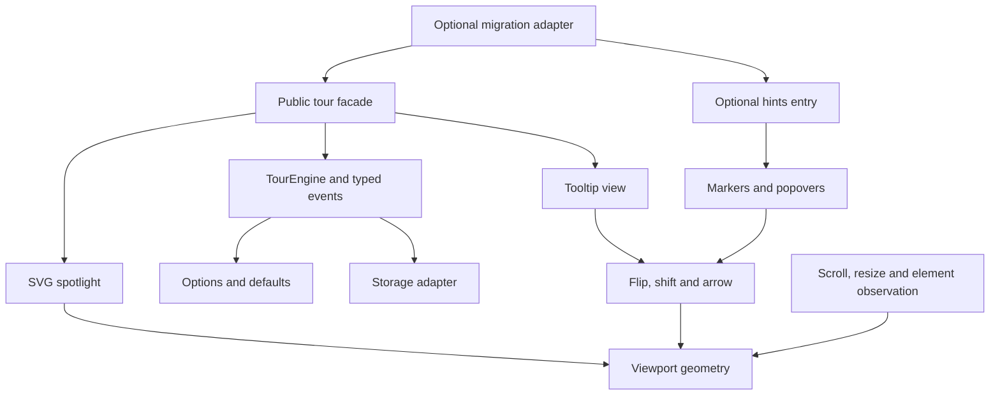
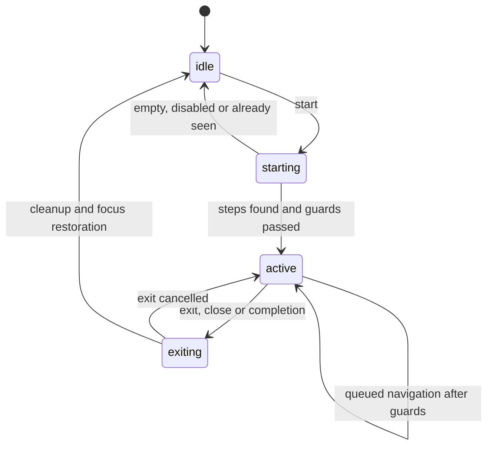

# TourKit: original design specification

> Historical proposal, 2026-07-12. This records the reasoning behind the initial
> implementation; it is not the current API reference. Later releases delivered
> several items originally listed as future work. See the README and
> `docs-site/guide/` for current behavior.

The design followed the behavior study in [introjs-analysis.md](introjs-analysis.md).

## 1. Goals and initial exclusions

### Goals

1. An independently implemented library distributed under MIT.
2. Product tours, target highlighting, navigable tooltips, contextual hints,
   declarative attributes and automatic positioning.
3. Host targets left in place, safe content rendering, accessible controls and
   SSR-safe imports.
4. Strict TypeScript, no runtime dependencies, ESM/CJS/global bundles, and
   small JavaScript and CSS budgets.
5. CSS custom properties, BEM hooks and logical properties for RTL.

### Initial exclusions

Routing across pages and framework wrappers were initially left to host code.
Language dictionaries and the Intro.js migration adapter were designed as
optional entries. Exact API compatibility was not a goal. Later versions added
built-in progress persistence and locale dictionaries.

## 2. Independent implementation boundaries

The implementation must not copy reference source, comments, SCSS or other
upstream content. TourKit uses its own package name, the `tk-` CSS prefix, and
`data-tour-*`/`data-hint-*` attributes. Intro.js names are limited to the
migration adapter and comparison documentation.

Distributions carry the MIT license and version/license banners. Public
provenance wording is: independently implemented; contains no Intro.js source
code; not affiliated with Intro.js. These are process requirements, not a legal
assessment. Historical package-name availability checks are not a guarantee
that an npm name remains available at publication time.

## 3. Architecture

### 3.1. Modules



Views have explicit mount, update and destroy lifecycles. The engine and
`autoUpdate` schedule work; no reactive DOM framework is required. Scroll and
resize work is coalesced through requestAnimationFrame.

### 3.2. Mounted layers

```text
body
  div.tk-root[data-tk-theme]        fixed viewport root, pointer-events: none
    svg.tk-overlay                 painted backdrop receives pointer events
    div.tk-interaction-guard       optional target interaction blocker
    div.tk-tooltip[role=dialog]    interactive tooltip
    div.tk-live[aria-live=polite]   visually hidden step announcements
```

The default root stacking level is 99999 through `--tk-z`. An SVG cutout lets
the underlying target remain visible and clickable without changing its
position or stacking level. Multiple cutouts use the same path. Teardown
removes the library's root rather than searching the document for classes.

### 3.3. Spotlight

- A viewport-sized SVG uses an even-odd path containing the outer rectangle
  and a rounded stage rectangle around the target.
- Stage geometry is the viewport target rectangle inflated by
  `overlay.padding`, initially proposed as 8 px, with an 8 px corner radius.
- Backdrop fill and opacity use `--tk-overlay-color` and `--tk-overlay-opacity`.
- A requestAnimationFrame loop interpolates x/y/width/height/radius with
  `easeInOutCubic` over the configured transition, initially 300 ms.
- A targetless step collapses the cutout toward the viewport center.
- Painted backdrop clicks can exit; the unpainted hole passes clicks through.
- Reduced-motion preference disables movement animation.

### 3.4. Tooltip positioning

Geometry uses viewport coordinates and fixed layers. `getBoundingClientRect`
feeds a side/alignment model:

```text
Side      = top | bottom | left | right
Align     = start | center | end
Placement = Side | Side-Align | center
```

The solver first tries the requested side, then the configured precedence
(bottom/top/right/left), then centered fallback. It shifts the tooltip inside
an 8 px viewport margin and clamps the arrow projection away from rounded
corners. Top/bottom and left/right use the same side/alignment model.

Render invisibly, measure actual tooltip size, position it, then show it.
Avoid guessed dimensions and timer-based correction. Observe scrolling,
window resizing and relevant element sizes for geometry updates. Host changes
that do not produce an observed geometry event require explicit refresh.

### 3.5. State machine



Transitions are asynchronous and serialized, so rapid clicks cannot race.
Before-step guards can cancel both directions; handlers inspect direction when
only forward movement should be blocked. The engine delegates rendering and
has no dependency on browser views, allowing isolated tests and custom UIs.

## 4. Proposed public API

### 4.1. Tour factory

```ts
import { createTour } from "tourkit";
import "tourkit/styles.css";

const tour = createTour({
  steps: [
    { target: "#save-btn", title: "Saving", content: "Click to save.", placement: "bottom" },
    {
      target: () => document.querySelector(".chart"),
      content: "Charts are generated automatically.",
    },
    { title: "Done!", content: "A centered floating step." },
  ],
});
tour.on("complete", ({ reason }) => console.log(reason));
await tour.start();
```

### 4.2. Options and step inputs

The proposal grouped options as follows. Actual current definitions are in
`src/core/types.ts`.

| Group               | Fields                                                                 |
| ------------------- | ---------------------------------------------------------------------- |
| Steps and mounting  | `steps`, `container`                                                   |
| Labels and controls | `labels`, `buttons`, `bullets`, `progress`, `stepNumbers`              |
| Placement           | `placement`, `placementPrecedence`                                     |
| Overlay             | `opacity`, `color`, `padding`, `radius`, `clickToExit`, `transitionMs` |
| Interaction         | `keyboard`, `exitOnEsc`, `disableInteraction`                          |
| Scrolling           | `block: center/nearest/off`, `behavior: smooth/auto`, `padding`        |
| Content             | `allowHTML`, `renderStep` with cleanup                                 |
| Persistence         | `showOnce` key, storage selection and optional checkbox                |
| Styling             | `theme`, `classes`, `zIndex`                                           |

Target references may be selectors, elements or functions returning an element
or null. Step inputs include title, content, placement, interaction/scroll
and tooltip-class overrides, `onBeforeShow`, and `onShown`. A missing target
uses centered placement. Later versions permit empty content with a custom
step renderer.

### 4.3. Methods and events

| Method                             | Contract                                             |
| ---------------------------------- | ---------------------------------------------------- |
| `start()`                          | Asynchronously start; report whether a tour is shown |
| `exit(force?)`                     | Asynchronously exit, respecting guards unless forced |
| `destroy()`                        | Immediate teardown and listener cleanup              |
| `next()`, `back()`, `goTo(index)`  | Queued, zero-based navigation                        |
| `refresh(rescanSteps?)`            | Update geometry and optionally rediscover steps      |
| `index`, `steps`, `isActive`       | Read-only state                                      |
| `setOptions(patch)`                | Apply a partial configuration                        |
| `on(event, cb)`, `once(event, cb)` | Subscribe and return an unsubscribe function         |

Events are `start`, cancellable `beforeStepChange`, `stepChange`, cancellable
`beforeExit`, `exit`, and `complete`. Step-change guards receive previous/next
indexes, direction, step and `cancel()`. Completion reasons are `finished`
and `skipped`. Multiple asynchronous subscribers are supported. Native events
use explicit cancellation rather than callback return values.

### 4.4. Declarative steps

```html
<button
  data-tour="Click to save"
  data-tour-title="Saving"
  data-tour-step="2"
  data-tour-group="onboarding"
  data-tour-placement="bottom-start"
  data-tour-no-interaction
></button>
```

`fromDataAttributes(root?, { group? })` reserves explicit numbered slots, fills
gaps in discovery order, and skips hidden elements.

### 4.5. Hints

```ts
import { createHints } from "tourkit/hints";

const hints = createHints({
  hints: [{ target: "#export", content: "Export to Excel", markerPosition: "top-end" }],
  marker: { pulse: true },
  popover: { button: true, buttonLabel: "Got it" },
});
hints.render();
hints.on("open", (event) => console.log(event));
```

Nine marker anchors combine top/middle/bottom with start/center/end. Markers
are real buttons positioned through the shared update mechanism. Hints share
the placement engine and storage adapter, with declarative `data-hint*` support.

### 4.6. Migration adapter

The adapter is an optional `tourkit/compat-introjs` entry. It maps legacy option
and callback names while reporting unsupported behavior. It is excluded from
the main bundle.

| Intro.js                               | TourKit                              |
| -------------------------------------- | ------------------------------------ |
| `intro`, `data-intro`                  | `content`, `data-tour`               |
| `bottom-middle-aligned`                | `bottom`                             |
| Left/right aligned variants            | Start/end alignment                  |
| `floating`                             | `center`                             |
| Before-change callback returning false | Cancellable `beforeStepChange` event |
| Completion callback                    | `complete` event                     |
| Cookie-based opt-out                   | `showOnce` with storage              |
| `helperElementPadding`                 | `overlay.padding`                    |
| `exitOnOverlayClick`                   | `overlay.clickToExit`                |
| One-based `goToStep(n)`                | Zero-based `goTo(n - 1)`             |
| `refresh(true)`                        | Rediscover declarative steps         |

See [introjs-migration.md](introjs-migration.md) for current migration details.

## 5. Accessibility requirements

1. Dialog semantics with labels/descriptions. Nonmodal tours leave the target
   interactive; modal behavior must be explicitly requested.
2. Initial focus, a predictable Tab cycle and restoration of the previous focus.
3. Real `button` elements for actions.
4. A valid progressbar role with minimum, maximum and current values.
5. Step buttons with descriptive labels and `aria-current="step"`.
6. A polite live region announcing step number and title.
7. Escape to exit, arrows to navigate, Home/End for boundaries, and normal
   Enter/Space activation without disrupting host input.
8. Reduced-motion support for spotlight and hint animations.
9. Contrast checks and axe-based browser coverage.

## 6. Styling

Use one stylesheet with BEM blocks and CSS custom properties. Themes are
selected on `data-tk-theme`; auto follows the system color scheme. Logical
properties and directional placement avoid a separate RTL stylesheet.

The initial proposal exposed z-index, backdrop color/opacity, surface, text,
muted text, accent/contrast, border, shadow, font, radius, maximum tooltip
width and transition variables. These values evolved; the exhaustive current
contract is [Theming](../docs-site/guide/theming.md).

Primary hooks include `.tk-overlay`, `.tk-tooltip`, tooltip header/title/content,
arrow, footer, bullets and active bullet, progress segments, primary/ghost
buttons, hint marker/pulse and hint popover. Keep layout local with border-box
sizing and flexbox. Avoid legacy browser hacks and unnecessary `!important`.

## 7. Content safety and CSP

Plain text is the default. Trusted HTML is opt-in, and complex content can be
built directly through `renderStep` with a cleanup callback. Later versions
add an explicit sanitizer hook for untrusted HTML. Avoid dynamic code evaluation.

An external stylesheet avoids injected style tags. The optional style injector
uses constructable stylesheets where supported, with a nonce-capable style-tag
fallback. Consumers remain responsible for their own CSP configuration.

## 8. Packaging and environment support

| Area             | Design decision                                                              |
| ---------------- | ---------------------------------------------------------------------------- |
| Build            | ESM, CJS and browser-global JavaScript, declarations and CSS                 |
| Optional entries | Hints, migration adapter and stylesheet; later locales and style injection   |
| Target           | ES2020 and modern Chrome, Firefox, Safari and Edge                           |
| SSR              | No module-level access to browser globals; server-side start is a safe no-op |
| Dependencies     | Zero runtime dependencies; development tooling is separate                   |
| Initial budgets  | Approximately 10 KB gzip core, 3 KB additional hints and 3 KB CSS            |

The proposal considered Vite library mode or tsup. The implementation selected
tsup and IIFE globals. Current compression metrics and budgets are defined in
`package.json` and CI, rather than by these historical estimates.

## 9. Validation plan

- Unit tests cover engine transitions/cancellation/queues, placement cases,
  declarative discovery, storage and typed events.
- Browser tests exercise complete tours, close paths, keyboard, offscreen and
  fixed targets, transformed containers, hints and persistence.
- Accessibility checks cover open tooltips/popovers and focus behavior.
- Visual tests cover placement, centered steps and dark themes.

## 10. Source layout

The proposal separates core engine/events/options/storage, geometry and scroll
utilities, imperative UI views/focus management, tour step discovery and facade,
hints, compatibility code, styles, tests and demo. The initial estimate was
1200–1500 TypeScript lines; this was a planning estimate, not a current size claim.

## 11. Original roadmap

| Milestone | Planned work                                                                          | Acceptance                                            |
| --------- | ------------------------------------------------------------------------------------- | ----------------------------------------------------- |
| v0.1      | Engine, animated cutout, tooltip, controls, declarative steps, keyboard and scrolling | Complete demo and engine/placement unit coverage      |
| v0.2      | Hints, opt-out/storage, progress and dark theme                                       | Hint browser tests and accessibility checks           |
| v0.3      | Accessibility polish, custom rendering, adapter and RTL                               | Accessibility/reader smoke checks and migration guide |
| v1.0      | Stable API, CI budgets, docs site and npm release                                     | Semantic-versioning commitments                       |
| v1.x      | Framework wrappers, multiple cutouts and cross-page tours                             | Defined per feature                                   |

Some features arrived earlier than this proposal anticipated. Consult the
changelog for the actual release sequence.

## 12. Decision rationale

| Decision                                         | Reason                                                                      |
| ------------------------------------------------ | --------------------------------------------------------------------------- |
| SVG cutouts                                      | Keep targets in place, support multiple highlights and native click-through |
| Viewport coordinates                             | Avoid document-offset and nested-container arithmetic                       |
| Serialized state machine                         | Deterministic navigation and DOM-independent tests                          |
| Imperative views                                 | Explicit lifecycle and a small rendering layer                              |
| Text by default                                  | Safe content handling unless HTML is explicitly enabled                     |
| Typed events and cancellation                    | Multiple asynchronous subscribers and cleanup                               |
| Storage abstraction                              | Local/session/custom persistence without cookies                            |
| CSS variables, BEM and logical properties        | Runtime theming and RTL support                                             |
| Zero-based indexes and side/alignment placements | Consistent public semantics                                                 |
| SSR-safe modules                                 | Safe imports in server-rendered applications                                |
